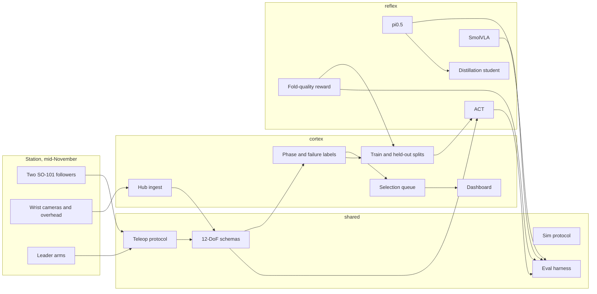

# Cortex-and-Reflex

Pre-hardware foundation for a bimanual [SO-101](https://github.com/huggingface/lerobot) cloth-folding stack.
Cortex is the data engine. Reflex is the policy stack. Both sit on LeRobot 0.6.x
and the LeRobotDataset v3 episode format. Arms are expected mid-November. Until
then the runnable path is the public towel dataset, CPU dry-runs for ACT,
SmolVLA, and pi0.5, a tiny fold-quality reward model, curation splits, offline
eval, a distillation student, and a mock station. The GPU configs are checked in
for a rented machine.

The first task is folding a towel. The second is folding a T-shirt.

## Architecture



| Path | Role |
| --- | --- |
| `shared/` | Joint names, camera keys, episode records, label types, curation splits |
| `cortex/` | Metadata ingest, VLM labeler, review queue, dashboard, episode curation |
| `reflex/` | ACT, SmolVLA, and pi0.5 launchers, reward model, offline eval, distillation, mock station |
| `configs/` | Dataset, labeler, curation, reward, eval, and policy hyperparameters |
| `docs/` | Episode format, label targets, and split files |
| `hardware/` | Teleop and record templates. Ports stay unset until the arms are enumerated |
| `infra/` | What CI runs without a GPU |
| `tests/` | Schema, ingest, labeling, reward, curation, dry-runs, eval, distill, mock station |

## Data contract

A frame is a 12-wide `float32` action, a 12-wide `float32` state, and three RGB cameras.
Joints use the `left_` / `right_` names from the public bimanual recordings
(`left_shoulder_pan.pos` through `right_gripper.pos`). Camera keys are
`observation.images.left`, `observation.images.right`, and `observation.images.top`
(left wrist, right wrist, overhead). Details and the v3 directory layout are in
[docs/data-format.md](docs/data-format.md).

Fold phases are `grasp_corner`, `flatten`, `fold`, and `release`. Failure tags are
`missed_grasp`, `crumpled_corner`, `misaligned_fold`, `double_layer_grasp`,
`arm_collision`, `timeout`, `drop`, and `missed_box`.

The checked-in loader reads
[`humjie/bimanual-so101-fold-towel`](https://huggingface.co/datasets/humjie/bimanual-so101-fold-towel)
(120 episodes, 30 fps, three cameras). It downloads `meta/` and checks it against
the contract. Video shards are left on the Hub.

## Setup

Requires Python 3.12 and [uv](https://docs.astral.sh/uv/).

```bash
uv sync
uv run ruff check .
uv run ruff format --check .
uv run mypy
uv run pytest
```

`uv sync` installs the workspace, including a CPU build of PyTorch. The first
resolve is large because LeRobot depends on torch.

Ingest the public towel metadata:

```bash
uv run python -m cortex.cli ingest
```

Label one synthetic episode and print the dashboard:

```bash
uv run python -m cortex.cli label-demo
```

Run one ACT step on CPU and write a checkpoint under `outputs/act_smoke`:

```bash
uv run python -m reflex.cli act-smoke --steps 1
uv run python -m reflex.cli policies
```

Label a few towel episodes with the placeholder backend (no model download):

```bash
uv run python -m cortex.cli label \
  --dataset humjie/bimanual-so101-fold-towel \
  --limit 2 \
  --backend fake
```

## Labeling and policies

`StubLabeler` cuts each episode into four equal phases and applies kinematic
rules (gripper motion, wrist oscillation, left/right lift agreement, action
spikes, episode length). Phase confidence stays at 0.25, so every stub label
lands on the review queue. `VlmLabeler.complete()` is the backend hook.
`BackendVlmLabeler` validates the reply, retries schema failures, and caches
accepted JSON. Swap the labeler in `run_labeling` without changing the queue or
dashboard.

A VLM label is segments `grasp`, `flatten`, `fold1`, `fold2`, and `release`,
plus `success` and `quality_notes`. Segments tile the episode. Their confidence
is copied onto the coarse phases (`grasp` → `grasp_corner`, `fold1` and `fold2`
→ `fold`), so a minimum under 0.5 still enters the review queue as
`uncertain_phase`. `success: false` is queued as a failure. The checked-in
command is:

```bash
# Local SmolVLM or Qwen2.5-VL. transformers is not installed in CI.
uv pip install 'transformers>=4.51'
uv run python -m cortex.cli label \
  --dataset humjie/bimanual-so101-fold-towel \
  --limit 2 \
  --backend hf \
  --model HuggingFaceTB/SmolVLM-256M-Instruct

# Any OpenAI-compatible chat endpoint. OPENAI_BASE_URL / OPENAI_API_KEY /
# OPENAI_MODEL are accepted when the CORTEX_VLM_* variables are unset.
export CORTEX_VLM_BASE_URL=https://api.openai.com/v1
export CORTEX_VLM_API_KEY=your-key
export CORTEX_VLM_MODEL=gpt-4o-mini
uv run python -m cortex.cli label --limit 2 --backend openai
```

`--download-videos` fetches the mp4 shards before labeling. Without it, only
`meta/` is read and the prompt carries video refs. `--root` points at a dataset
directory that is already on disk. Replies are cached under `outputs/vlm_cache`.
Real-model tests are marked `slow` and skip unless `CORTEX_RUN_SLOW_VLM=1`.

`reflex.registry` lists ACT, SmolVLA, pi0.5, and the distillation student as
ready. Diffusion Policy stays planned. The smoke test builds `ACTPolicy` from
LeRobot 0.6.1 with `pretrained_backbone_weights=None`, 64×64 images, and a
64-wide transformer, then takes one optimizer step and calls `select_action`.

## Train ACT on a rented GPU

`configs/policies/act_towel_gpu.yaml` trains LeRobot 0.6 ACT on
`humjie/bimanual-so101-fold-towel`: 12-DoF actions and state, cameras
`observation.images.left`, `observation.images.right`, and `observation.images.top`.
Checkpoints go to `outputs/train/act_towel` every 2000 steps, which is enough to
restart a spot instance. W&B is off unless `wandb.enable` is true or you pass
`--wandb`.

The workspace lockfile pins CPU torch so CI stays small. On an A100, L40S, or
RTX 4090, install a CUDA torch build and the LeRobot training extra, then launch:

```bash
uv pip install torch torchvision --index-url https://download.pytorch.org/whl/cu128
uv pip install 'lerobot[training]'
uv run python -m reflex.cli train --config configs/policies/act_towel_gpu.yaml
```

Use the CUDA index that matches the driver if `cu128` does not. Re-run that
command after a preemption. When `outputs/train/act_towel/checkpoints/last`
exists, the launcher passes LeRobot `--resume=true` and that checkpoint's
`train_config.json`. On a 24 GB 4090, set `batch_size` to 2 if the run runs out
of memory.

Check the wiring on CPU before paying for the GPU. This does not download the
dataset:

```bash
uv run python -m reflex.cli train \
  --config configs/policies/act_towel_cpu_dry_run.yaml \
  --output outputs/train/act_towel_cpu_dry_run
```

The dry-run takes one synthetic step with the same three cameras and a 12-DoF
action, writes `checkpoints/last`, and resumes when you launch it again.

Check each new piece on CPU before renting a GPU. None of these download
SigLIP 2, SmolVLM, or PaliGemma:

```bash
uv run python -m reflex.cli reward-train --config configs/reward/fold_quality_cpu.yaml
uv run python -m reflex.cli reward-eval --config configs/reward/fold_quality_cpu.yaml
uv run python -m reflex.cli train --config configs/policies/smolvla_towel_cpu_dry_run.yaml
uv run python -m reflex.cli train --config configs/policies/pi05_towel_cpu_dry_run.yaml
uv run python -m reflex.cli eval-offline --config configs/eval/offline_cpu.yaml
uv run python -m reflex.cli distill --config configs/policies/student_towel_cpu.yaml
uv run python -m reflex.cli bench --config configs/policies/student_towel_cpu.yaml --strict
uv run python -m reflex.cli record-plan
uv run python -m reflex.cli deploy
uv run python -m reflex.cli record-mock
```

The offline config points at the GPU checkpoint directories, so the CPU command
above is the one CI overrides in a temp directory. Point `policies:` at the
dry-run `pretrained_model` folders if you want a local report.

## Fold-quality reward model

`configs/reward/fold_quality_gpu.yaml` trains a SigLIP 2 tower
(`google/siglip2-base-patch16-224`) plus a small head. The head scores fold
quality and success on each frame, and success on the episode after mean
pooling. Targets come from Cortex VLM labels: a successful episode starts at 1,
phase spans replace quality with that span's confidence, and a failure span
hard-zeros quality and success. Metrics are AUROC and expected calibration
error on the held-out episodes.

Frames are PNGs at
`{images_dir}/{episode}/{observation.images.left|right|top}/{frame:06d}.png`.
`annotations` is the JSONL from `cortex.cli label`. The encoder stays frozen.
On a 24 GB GPU, drop `batch_size` to 4 if the tower runs out of memory.

```bash
uv pip install torch torchvision --index-url https://download.pytorch.org/whl/cu128
uv pip install 'transformers>=4.51'
uv run python -m reflex.cli reward-train --config configs/reward/fold_quality_gpu.yaml
uv run python -m reflex.cli reward-eval --config configs/reward/fold_quality_gpu.yaml
```

Checkpoints land in `outputs/reward/fold_quality/checkpoints/last` every 500
steps. Re-run the same command after a preemption (`resume: auto`). CI uses
`configs/reward/fold_quality_cpu.yaml`, a tiny conv encoder on synthetic bright
success frames and dark failure frames. It does not download SigLIP.

## SmolVLA and pi0.5

Both GPU configs full-fine-tune the public base weights on the same 12-DoF,
three-camera contract. The launcher passes `--policy.type` and
`--policy.pretrained_path`, so the dataset supplies
`observation.images.left`, `right`, and `top`. Do not switch this to
`--policy.path`: that loads the checkpoint's camera names and ignores the
dataset. The language prompt is the dataset task, `Fold towel`. Vision encoder
and VLM both train (`freeze_vision_encoder: false`, `train_expert_only: false`).
SmolVLA also sets `load_vlm_weights: true`, `pad_language_to: max_length`,
`prefix_length: 0`, and `num_expert_layers: 0` so the VLM is the base checkpoint
rather than a random init. Checkpoints every 2000 steps. `push_to_hub` stays
false. Re-running the command resumes from `checkpoints/last`.

SmolVLA (`lerobot/smolvla_base`) fits a 24 GB card if you lower `batch_size`
from 8 to 1 or 2. pi0.5 (`lerobot/pi05_base`, PaliGemma `gemma_2b`, expert
`gemma_300m`, bfloat16, gradient checkpointing) needs an 80 GB A100 at
`batch_size: 4`. A 24 GB card will run out of memory; `batch_size: 1` is the
first thing to try, and it may still be too large.

```bash
uv pip install torch torchvision --index-url https://download.pytorch.org/whl/cu128
uv pip install 'lerobot[training,smolvla]'
uv run python -m reflex.cli train --config configs/policies/smolvla_towel_gpu.yaml

uv pip install 'lerobot[training,pi]'
uv run python -m reflex.cli train --config configs/policies/pi05_towel_gpu.yaml
```

`lerobot[training]` installs accelerate, which the real launch requires. CPU
dry-runs are a 12-to-12 linear layer and one optimizer step. They write the
same checkpoint layout, including `task_prompt.txt`, and do not download
SmolVLM or PaliGemma.

To train a curated subset, set `episodes_file` to a split JSON and
`episodes_split: train`. A fresh launch appends `--dataset.episodes=[...]`.
Resume ignores that flag and reuses the checkpoint config.

## Offline evaluation

`reflex.cli eval-offline` scores ACT, SmolVLA, and pi0.5 checkpoints on a
held-out episode split: action MSE, per-joint MSE, and, when
`reward_checkpoint` is set, the reward model's episode success probability.
It writes `report.json` and `report.md`.

Until the towel videos are on disk the harness synthesizes episodes
(`synthetic: true`). An identity mock has action MSE 0.0625 on that data
(each joint is 0.25 above the state). `split_file` replaces the random holdout
when every listed index exists in the episode set. Real frame tensors are the
next wiring once a local dataset exists; `synthetic: false` refuses to invent
them.

```bash
# After the GPU runs, point policies: at each checkpoints/last/pretrained_model
# and reward_checkpoint at outputs/reward/fold_quality/checkpoints/last.
uv run python -m reflex.cli eval-offline --config configs/eval/offline_cpu.yaml
```

## Curation

`cortex.cli curate` ranks labeled episodes and writes a version-1 split JSON
(`train_episodes`, `held_out_episodes`, and a same-size random baseline).
Strategies:

- `quality`: mean phase confidence, with a bonus for `success: true` and a
  penalty for a failed episode or any failure span
- `diversity`: greedy farthest-point over phase, failure, and success features,
  starting from the highest-quality episode
- `reward`: the same ranking using an external score file
- `random`: the baseline itself

At least one episode is held out when there is more than one. Reward scores are
`{"0": 0.8}` or `{"scores": {"0": 0.8}}`.

```bash
uv run python -m cortex.cli curate \
  --annotations outputs/labels/annotations.jsonl \
  --output outputs/splits/quality.json \
  --config configs/curation/quality.yaml

uv run python -m cortex.cli curate \
  --annotations outputs/labels/annotations.jsonl \
  --output outputs/splits/reward.json \
  --strategy reward \
  --reward-scores outputs/reward/episode_scores.json
```

Point a training config's `episodes_file` at that JSON to consume the train half.

## Distillation

`configs/policies/student_towel_gpu.yaml` is a patch-transformer student of
about 72M parameters (the 50-150M band). The KD loop regresses the student
action chunk onto the teacher's action chunk. The teacher is either scripted
(repeat the state) or a checkpoint. A checkpoint is accepted when it is a CPU
mock (`config.json` has `mock: true`) or when `actions.pt` sits next to it with
shape `(chunk, 12)` or `(12,)`. A real pi0.5 or SmolVLA directory without one of
those raises `DistillError` instead of downloading the teacher. The training
batch is synthetic until the dataset videos are local. Checkpoints every 2000
steps, and `resume: auto` reloads `checkpoints/last`.

`reflex.cli bench` times a batch-1 forward and estimates inference VRAM
(parameters in fp16 plus activation working room). The target is 30 Hz and
under 6 GB. `--strict` exits 1 when either target is missed. The tiny CPU
student meets both. Run the GPU student on the rented card:

```bash
uv pip install torch torchvision --index-url https://download.pytorch.org/whl/cu128
# Export teacher chunks to actions.pt, or point teacher_checkpoint at a mock.
uv run python -m reflex.cli distill --config configs/policies/student_towel_gpu.yaml
uv run python -m reflex.cli bench \
  --config configs/policies/student_towel_gpu.yaml \
  --strict
```

## Hardware stubs

`hardware/teleop_bimanual_so101.yaml` and `hardware/record_bimanual_so101.yaml`
are the bimanual SO-101 record plan: `bi_so_follower` and `bi_so_leader`, three
cameras, task `Fold towel`, 30 fps. Ports and camera indexes are null. Do not
invent `/dev` paths until the station is enumerated. `record-plan` prints the
`lerobot-record` command with `<unset>` in those slots.

`deploy` runs the inference loop on `MockBimanualRobot` with a state-copy
policy and the task string `Fold towel`. `record-mock` records one episode from
`MockLeaderTeleop`. Both run with no arms attached.

## Roadmap

1. **This checkout.** Monorepo, v3 schema, Hub metadata loader, VLM labeler,
   curation splits, fold-quality reward model, ACT / SmolVLA / pi0.5 launchers
   with CPU dry-runs, offline eval, distillation scaffold, teleop templates,
   mock deploy loop, CI.
2. **Rented GPU, still before the arms.** Label towel episodes, curate a split,
   train the SigLIP reward model, and full-fine-tune ACT, SmolVLA, and pi0.5.
   Export teacher `actions.pt` and run the student bench on that GPU. Diffusion
   Policy stays planned.
3. **Mid-November station.** Two SO-101 followers, two leaders, three cameras.
   Fill the ports in the hardware templates, record towel episodes, and run
   `cortex ingest --root` on the new dataset before any long train.
4. **Towel policy.** Compare the three checkpoints with `eval-offline` once real
   frames are local. The reward model is the automatic score; a human judge
   (fold flat, inside the target region) still belongs on the station.
5. **T-shirt.** Same 12-DoF contract, longer episodes, phase labels extended for
   sleeves. Reuse the failure taxonomy where it still applies.
6. **Distillation on real actions.** The student loop and the 30 Hz / 6 GB bench
   are in this checkout. The next step is KD on recorded towel chunks instead of
   the synthetic batch.

## License

Apache-2.0. LeRobot itself is Apache-2.0; this repo depends on it and does not
vendor it.
