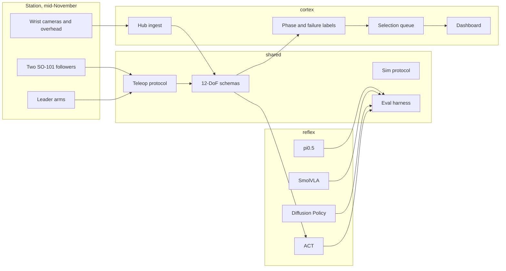

# Cortex-and-Reflex

Pre-hardware foundation for a bimanual [SO-101](https://github.com/huggingface/lerobot) cloth-folding stack.
Cortex is the data engine. Reflex is the policy stack. Both sit on LeRobot 0.6.x
and the LeRobotDataset v3 episode format. Arms are expected mid-November; until
then the runnable path is a public towel dataset plus a CPU ACT smoke test.

The first task is folding a towel. The second is folding a T-shirt.

## Architecture



| Path | Role |
| --- | --- |
| `shared/` | Joint names, camera keys, episode records, label types, sim/teleop/eval protocols |
| `cortex/` | Metadata ingest, stub labeler, VLM interface, review queue, text dashboard |
| `reflex/` | Policy registry and the ACT CPU smoke entry point |
| `configs/` | Dataset repo, stub-miner thresholds, ACT smoke hyperparameters |
| `docs/` | Episode format |
| `hardware/` | Station notes for the November bring-up |
| `infra/` | What CI runs without a GPU |
| `tests/` | Schema, ingest, labeling, and the ACT smoke step |

## Data contract

A frame is a 12-wide `float32` action, a 12-wide `float32` state, and three RGB cameras.
Joints use the `left_` / `right_` names from the public bimanual recordings
(`left_shoulder_pan.pos` through `right_gripper.pos`). Camera keys are
`observation.images.left`, `observation.images.right`, and `observation.images.top`
(left wrist, right wrist, overhead). Details and the v3 directory layout are in
[docs/data-format.md](docs/data-format.md).

Fold phases are `grasp_corner`, `flatten`, `fold`, and `release`. Failure tags are
`missed_grasp`, `crumpled_corner`, `misaligned_fold`, `double_layer_grasp`,
`arm_collision`, `timeout`, `drop`, and `missed_box`.

The checked-in loader reads
[`humjie/bimanual-so101-fold-towel`](https://huggingface.co/datasets/humjie/bimanual-so101-fold-towel)
(120 episodes, 30 fps, three cameras). It downloads `meta/` and checks it against
the contract. Video shards are left on the Hub.

## Setup

Requires Python 3.12 and [uv](https://docs.astral.sh/uv/).

```bash
uv sync
uv run ruff check .
uv run ruff format --check .
uv run mypy
uv run pytest
```

`uv sync` installs the workspace, including a CPU build of PyTorch. The first
resolve is large because LeRobot depends on torch.

Ingest the public towel metadata:

```bash
uv run python -m cortex.cli ingest
```

Label one synthetic episode and print the dashboard:

```bash
uv run python -m cortex.cli label-demo
```

Run one ACT step on CPU and write a checkpoint under `outputs/act_smoke`:

```bash
uv run python -m reflex.cli act-smoke --steps 1
uv run python -m reflex.cli policies
```

## Labeling and policies

`StubLabeler` cuts each episode into four equal phases and applies kinematic
rules (gripper motion, wrist oscillation, left/right lift agreement, action
spikes, episode length). Phase confidence stays at 0.25, so every stub label
lands on the review queue. `VlmLabeler` builds the prompt, parses the JSON
response into the same `EpisodeAnnotation`, and leaves `complete()` for a future
client. Swap the labeler in `run_labeling` without changing the queue or dashboard.

`reflex.registry` lists ACT (ready), Diffusion Policy, SmolVLA, and pi0.5
(planned). The smoke test builds `ACTPolicy` from LeRobot 0.6.1 with
`pretrained_backbone_weights=None`, 64×64 images, and a 64-wide transformer, then
takes one optimizer step and calls `select_action`.

## Roadmap

1. **This checkout.** Monorepo, v3 schema, Hub metadata loader, stub labeler plus
   VLM interface, selection queue, text dashboard, ACT CPU smoke test, CI.
2. **Before the arms arrive.** Attach a VLM client to `VlmLabeler.complete`.
   Review queued episodes against the public towel videos. Add LeRobot
   `delta_timestamps` training configs for ACT on a GPU machine. Keep Diffusion
   Policy, SmolVLA, and pi0.5 behind their extras until that machine exists.
3. **Mid-November station.** Two SO-101 followers, two leaders, three cameras.
   Implement `TeleopSession`, record towel episodes, and run `cortex ingest --root`
   on the new dataset before any long train.
4. **Towel policy.** Train ACT and one VLA baseline. Fill `EvalHarness` with a
   real success judge (fold flat, inside the target region).
5. **T-shirt.** Same 12-DoF contract, longer episodes, phase labels extended for
   sleeves. Reuse the failure taxonomy where it still applies.
6. **Reward model and distillation.** A fold-quality reward model, then distill
   pi0.5 into the small ACT student. Interfaces for that training stay out of
   this checkout until the towel policy has an eval number.

## License

Apache-2.0. LeRobot itself is Apache-2.0; this repo depends on it and does not
vendor it.
